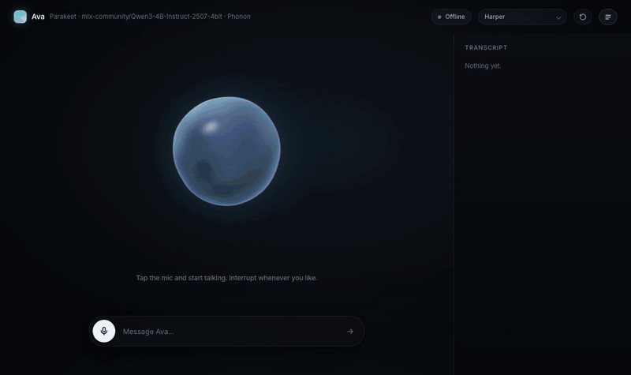
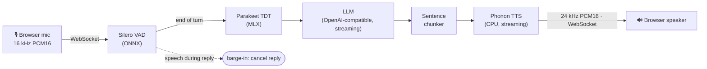

<div align="center">

# Ava — a real-time local voice agent

**Talk to an LLM out loud, interrupt it mid-sentence, and hear it answer in about a second.**
Speech recognition and speech synthesis run on your Mac; the LLM can be any OpenAI-compatible endpoint, or fully local.



<sub>Typed demo at 2× speed (recordings are silent). [Full-speed MP4](docs/demo.mp4) · [Screenshot](docs/screenshot.png)</sub>

</div>

---

## Features

- **Streaming end to end.** The LLM streams into a sentence chunker, and each chunk is spoken while the model keeps writing, so the first audio goes out as soon as the first clause exists.
- **Barge-in.** Start talking while Ava is speaking and she stops; history keeps only what was actually said aloud, so the conversation stays truthful.
- **On-device speech.** [Silero VAD](https://github.com/snakers4/silero-vad) for speech detection, [Smart Turn v3](https://github.com/pipecat-ai/smart-turn) (8 MB ONNX) to decide when you've actually finished, [Parakeet TDT 0.6B](https://huggingface.co/mlx-community/parakeet-tdt-0.6b-v3) on MLX for ASR (optionally the smaller, ~30 ms faster [Parakeet Redux](https://huggingface.co/moondream/parakeet-redux), slightly less accurate in noise), and [Phonon](https://huggingface.co/gradium/phonon-31m-en) (31M, CPU, streaming) for TTS.
- **Bring any LLM.** DeepSeek V3.2 on Amazon Bedrock by default, any OpenAI-compatible API, or `./run.sh --local` to serve Gemma 3 4B on your Mac with `mlx_lm.server`.
- **Live latency readout.** The UI shows voice-to-voice, ASR and LLM time-to-first-token for every turn.
- **Dozens of voices**, switchable live from the header, plus typed input that skips ASR.

## How it works



| Stage | What happens |
| --- | --- |
| **Turn detection** | 32 ms VAD frames. Three voiced frames start a turn (with ~320 ms of pre-roll kept). After `TURN_CHECK_MS` of silence, Smart Turn judges from the audio whether you're done; ASR is started speculatively at the same moment, so the transcript is usually ready when the turn commits. If you're only pausing, it re-checks every `TURN_CHECK_MS` up to `END_SILENCE_MS`. |
| **ASR** | The whole utterance is transcribed by Parakeet on a single worker thread. |
| **LLM** | Replies stream token by token; the first chunk may end at a comma so speech starts sooner. |
| **TTS** | Each chunk is synthesized and streamed to the browser in pieces while the next chunk is still being written. |
| **Playback** | An AudioWorklet plays the audio and reports playback state, which drives barge-in and the animated orb. |

## Quick start

Requires an **Apple Silicon Mac** (MLX), [uv](https://docs.astral.sh/uv/), and a browser with mic access.

```bash
git clone https://github.com/shri30yans/voice-agent.git
cd voice-agent
cp .env.example .env    # add your LLM key, or skip it and use --local
./run.sh
```

Then open **http://127.0.0.1:8000**, tap the mic and start talking. Use headphones so Ava doesn't hear herself.

The first run creates a Python 3.11 virtualenv, installs dependencies and downloads the VAD model; the ASR and TTS weights download from Hugging Face on first start.

To run fully offline, serving Gemma 3 4B locally with `mlx_lm.server`:

```bash
./run.sh --local
```

Set `LOCAL_LLM` to use a different MLX model.

## Configuration

All settings live in `.env` (see [`.env.example`](.env.example)).

| Variable | Default | Description |
| --- | --- | --- |
| `LLM_BASE_URL` | Bedrock Mantle (us-west-2) | Any OpenAI-compatible Chat Completions endpoint |
| `LLM_API_KEY` | – | API key for that endpoint |
| `LLM_MODEL` | `deepseek.v3.2` | Model name |
| `LLM_MAX_TOKENS` | `300` | Cap on reply length |
| `TTS_VOICE` | `Harper` | Starting voice (any English Phonon voice; switchable in the UI) |
| `TURN_CHECK_MS` | `200` | Silence before Smart Turn is first asked whether you're done (then re-asked every interval) |
| `TURN_THRESHOLD` | `0.5` | Smart Turn probability that counts as "done". Higher waits longer, lower cuts in sooner |
| `END_SILENCE_MS` | `900` | Longest pause tolerated before the turn is forced to end |
| `BARGE_IN_MS` | `250` | How long you must talk over Ava to interrupt her |
| `VAD_THRESHOLD` | `0.5` | Speech probability threshold |
| `ASR_BACKEND` | `mlx` | `mlx` (Parakeet TDT via parakeet-mlx) or `redux` (Moondream Parakeet Redux; first `uv pip install "moondream>=2.4.0" "torch>=2.12,<2.15"`) |
| `ASR_MODEL` | `mlx-community/parakeet-tdt-0.6b-v3` | Model for the chosen backend (`moondream/parakeet-redux` when `ASR_BACKEND=redux`) |
| `SYSTEM_PROMPT` | Ava persona | Overrides the built-in, speech-friendly system prompt |
| `PORT` | `8000` | Server port |

## Project layout

```
server.py          FastAPI app: WebSocket session, VAD, ASR, LLM streaming, TTS
static/index.html  Single-file UI: mic capture, playback worklets, WebGL orb, transcript
run.sh             Sets up the venv, fetches the VAD model, optionally starts a local LLM
.env.example       Configuration template
```

## WebSocket protocol

`/ws` carries binary audio both ways (16 kHz PCM16 up, 24 kHz PCM16 down) plus JSON control messages:

- **Client → server:** `playback`, `voice`, `reset`, `text`
- **Server → client:** `ready`, `vad`, `user`, `assistant`, `interrupt`, `metrics`, `assistant_done`, `error`
